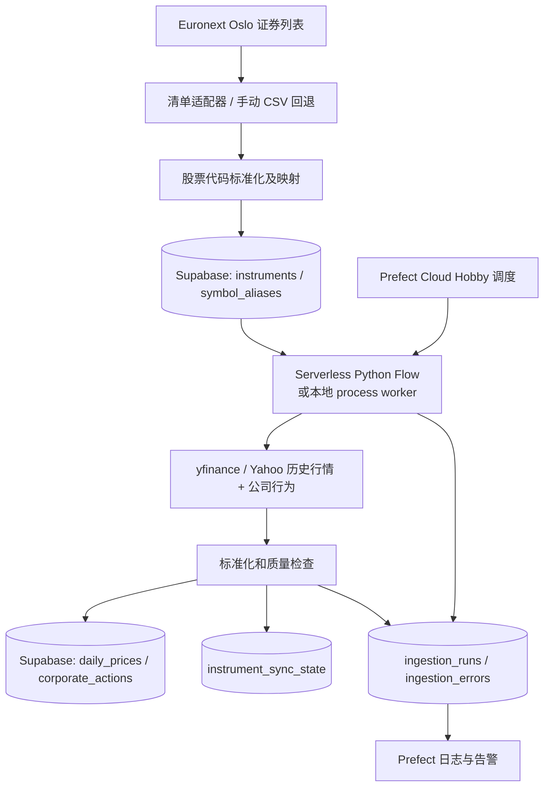

# 挪威股票历史数据采集系统 — 系统设计文档

**版本：** v1.2　**日期：** 2026-10-12　**状态：** MVP 设计　**目标：** 个人研究与分析，尽可能维持 $0/月

## 1. 概述

构建一套自动采集挪威上市股票名单和 OHLCV 日线历史数据的系统：从 Euronext 获取证券主数据，将代码映射到 Yahoo Finance；通过 yfinance 抓取历史行情及公司行为（拆股、分红）；使用 Prefect Cloud Hobby 负责定时编排和 Serverless 执行；持久化到 Supabase 免费 PostgreSQL。提供可重复执行、断点恢复、质量校验、告警和后续分析的基础。

**关键判断：** 该架构作为个人项目可行，但 $0 并非服务等级承诺。Prefect Cloud Hobby 当前额度为最多 5 个 Deployments、500 Serverless 分钟/月、运行记录保留 7 天；Supabase Free 为每项目 500 MB 数据库空间，且低活跃度项目可能暂停。yfinance 不是官方市场数据接口，不保证全量股票可用，也不保证请求稳定性及再分发授权。Yahoo 对数据中心 IP（包括 Serverless 和 CI 环境）的限流和封禁通常比家用网络严格，云端执行能否稳定抓取必须在阶段 2 实测，并预留本地执行的回退方案（见 §3）。

## 2. 范围

### MVP 范围
- 证券清单：Oslo Børs、Euronext Growth Oslo、Euronext Expand Oslo，股票为主；储蓄银行 equity certificates 可作为后续扩展。
- 主数据：证券名、ISIN、交易代码、市场、报价币种、活跃状态、抓取时间；记录代码映射及有效性。
- 日线：交易日、Open/High/Low/Close、Adjusted Close（如源可得）、Volume、来源、采集时间。
- 公司行为：拆股/合股比例、现金分红，用于检测历史价格调整并触发全量重取。
- 首次回填最多 10 年；随后每日增量同步，定期回看以捕获价格调整。
- 去重、重试、审计、运行告警、数据缺口检测和最低限度备份。

### 非 MVP
- 实时或分钟级行情、委托簿、交易执行、投资建议。
- 全部退市证券的完整历史覆盖、自动化企业行为清算、商业数据再分发。
- 面向外部用户的公开数据 API（需另行评估许可证与安全）。

### 已知局限
- **幸存者偏差：** 证券退市后 Yahoo 通常不再提供其历史数据，本系统只能保留开始采集之后已入库的数据。基于本库的回测会系统性高估收益，研究结论需注明此偏差。因此应尽早开始采集，且任何情况下不删除已入库的价格历史。

## 3. 架构



**控制面与执行面区别：** Prefect Cloud 负责调度、日志、编排；必须将 Flow 部署到实际运行环境。MVP 首选 Prefect Serverless，不能把免费 Cloud 调度误认为所有 Python 代码都会自动在云端运行。确认所用部署模式支持需要的 Python 依赖及外部 HTTPS/数据库访问，再发布。

**执行环境回退：** 如果阶段 2 实测发现 Serverless 出口 IP 被 Yahoo 频繁 429 或拒绝，改用自托管 Prefect process worker（家用机器或常开的小主机），调度和日志仍由 Prefect Cloud 提供，且不消耗 Serverless 分钟数。代价是可用性依赖本地机器在线。

## 4. 组件选择

| 组件 | 选择 | 理由 | 风险或限制 |
|---|---|---|---|
| 证券清单 | Euronext Oslo 官方网页/允许下载的清单 | 官方证券身份、所属市场和报价币种 | 页面结构可能变化；下载及自动抓取须遵守站点使用条款 |
| 历史行情 | yfinance | 免费、Python 易用，支持批量日线和公司行为 | 非官方接口、429、符号不全、数据调整差异；数据中心 IP 限流更严 |
| 交易日历 | `exchange_calendars`（`XOSL`） | 开源维护的 Oslo 交易日及假日 | 临时休市需人工补充 |
| 编排及运行 | Prefect Cloud Hobby + Serverless（回退：本地 process worker） | 免自建 Prefect Server，支持计划任务 | 5 个 deployments、500 分钟/月、7 天日志保留 |
| 数据库 | Supabase Free PostgreSQL | SQL 查询和唯一键 upsert | 500 MB、项目可能暂停、免费版无自动备份；直连默认仅 IPv6 |
| 代码、CI 与备份 | GitHub + 本地开发；GitHub Actions 定期 `pg_dump` | 版本管理、测试、异地备份 | 私钥不得写入代码仓库；备份产物不得公开 |

## 5. 数据流与任务

### Flow A: sync_instruments（每周，建议周日）
1. 下载许可范围内的 Euronext 清单；如果无法自动获取则导入已下载 CSV（保留原始快照与来源时间）。
2. 规范化字段，过滤不属于目标股票类别的证券；按 ISIN + 市场/上市地点识别挂牌实例。
3. 报价币种以 Euronext 清单为准（Oslo 有相当数量以 USD/EUR 报价的证券，不能默认 NOK），并与 Yahoo 返回的 currency 交叉校验，不一致时标记 mapping_review。
4. 生成候选 Yahoo 代码（通常为 `<symbol>.OL`），并通过单股历史查询验证；不能仅靠拼接断言有效。
5. 按稳定内部 ID 更新 instruments，映射记录存 symbol_aliases（同一证券同一 provider 同时只能有一条生效映射）；依据 `instrument_sync_state.consecutive_missing` 连续多期缺失时标记 inactive_candidate，人工核查后改为 inactive；不能把一次抓取失败认定为退市。
6. 输出统计：新增、修改、缺失、无法映射、币种不一致、成功验证数量。

### Flow B: sync_daily_prices（交易日夜间，建议 Europe/Oslo 22:00）
1. 用 `XOSL` 交易日历判断当天是否交易日，非交易日直接退出（不消耗 Serverless 分钟数）。
2. 读取 active 且映射验证通过的股票。
3. 对每个 symbol 使用 `instrument_sync_state.last_price_date`（无记录时回退为 `MAX(trade_date)`）决定开始日期；向前回看 5–10 个交易日以处理最近修订。
4. `yf.download` 一次调用只能使用一个开始日期：按开始日期分组；同组 20–30 个代码一批，组内开始日期不同时取最早者，多取的行由 upsert 覆盖。低并发执行；股票单独失败时缩小范围重试。
5. 同时以 `actions=True` 获取拆股和分红；若发现 corporate_actions 中尚未存在的事件，将该股票加入全量重取队列（`instrument_sync_state.needs_full_refetch = TRUE`），由 Flow C 处理。
6. 清理时区、列名、空值、数据类型；丢弃 OHLC 全空的行（Yahoo 在假日偶尔返回 NaN 行）；不写入晚于最近已收盘交易日的行，避免盘中部分数据入库。保留 `auto_adjust=False` 配置，防止混淆调整价格。
7. 将校验通过的记录批量 UPSERT，并更新 `instrument_sync_state`；失败项写 ingestion_errors。
8. 汇总并通知：本次成功/失败 ticker、写入行数、新检测到的公司行为、运行分钟数、数据延迟。

### Flow C: backfill_history（手动触发 / 首次部署 / 公司行为触发的全量重取）
- 逐批为每只股票拉取 10 年日线数据及公司行为；进度写入 `instrument_sync_state`，可断点续跑。
- 处理 `needs_full_refetch = TRUE` 的股票：重取全部历史，UPSERT 覆盖，完成后清除标记并记录修订行数。
- 控制每次 Flow 的最大执行时间（例如 10 分钟），避免 Prefect 免费额度被单次回填耗尽；未完成部分留待下次运行。
- 支持 `--tickers`, `--start`, `--end`, `--batch-size`, `--refetch-pending`, `--dry-run` 参数。
- 对停牌、IPO 之后才有数据、退市、映射失败等区分状态，不能视为抓取错误一概重试。

### Flow D: reconcile_recent_prices（每周）
- 重取最近 30–60 个交易日，对比 close、volume 和更新后的调整口径；必要时 UPSERT 修订数据。
- 对所有 active 股票重取公司行为列表，与 corporate_actions 比对，补登遗漏事件并标记全量重取（覆盖 Flow B 未能抓到的事件）。
- 运行 §7 的拆股附近跳变检测和长时间缺数据检测；对 `source_gap` 区间重试抓取。
- 每月抽样比较外部可信来源；记录差异而非静默覆盖大量历史。

**为什么需要全量重取：** 短期回看只能修正最近的数据。拆股会改变 Yahoo `Close` 的整段历史，分红会改变 `Adj Close` 的整段历史，只有检测到公司行为后对该股票全量重取才能保持全表口径一致。按约 300 只股票、每只每年 1–4 次事件估算，每年约数百次单股全量请求，成本可接受。

## 6. PostgreSQL 数据模型

```sql
CREATE TABLE instruments (
    instrument_id BIGSERIAL PRIMARY KEY,
    isin VARCHAR(12),
    exchange_symbol TEXT NOT NULL,
    name TEXT NOT NULL,
    market TEXT NOT NULL,
    currency CHAR(3) NOT NULL,              -- 报价币种，取自 Euronext 清单，不设默认值
    instrument_type TEXT DEFAULT 'common_stock',
    status TEXT NOT NULL DEFAULT 'active',  -- active / suspended / inactive_candidate / inactive / mapping_review
    first_seen_at TIMESTAMPTZ DEFAULT now(),
    last_seen_at TIMESTAMPTZ DEFAULT now(),
    UNIQUE (market, exchange_symbol)
);

CREATE TABLE symbol_aliases (
    alias_id BIGSERIAL PRIMARY KEY,
    instrument_id BIGINT NOT NULL REFERENCES instruments(instrument_id),
    provider TEXT NOT NULL,
    provider_symbol TEXT NOT NULL,
    valid_from DATE NOT NULL DEFAULT CURRENT_DATE,
    valid_to DATE,
    is_verified BOOLEAN NOT NULL DEFAULT FALSE,
    UNIQUE (provider, provider_symbol, valid_from)
);

-- 同一证券在同一 provider 下同时只能有一条生效映射
CREATE UNIQUE INDEX uq_alias_open_per_instrument
    ON symbol_aliases (instrument_id, provider) WHERE valid_to IS NULL;
-- 同一 provider 代码同时只能指向一只证券
CREATE UNIQUE INDEX uq_alias_open_per_symbol
    ON symbol_aliases (provider, provider_symbol) WHERE valid_to IS NULL;

CREATE TABLE daily_prices (
    instrument_id BIGINT NOT NULL REFERENCES instruments(instrument_id),
    trade_date DATE NOT NULL,
    open DOUBLE PRECISION, high DOUBLE PRECISION,
    low DOUBLE PRECISION, close DOUBLE PRECISION,   -- Yahoo Close：已拆股调整，未分红调整
    adj_close DOUBLE PRECISION,                     -- Yahoo Adj Close：拆股 + 分红调整
    volume BIGINT,
    source_id SMALLINT NOT NULL DEFAULT 1,          -- 1 = yahoo；用编码代替 TEXT 以缩小行宽
    fetched_at TIMESTAMPTZ NOT NULL DEFAULT now(),
    PRIMARY KEY (instrument_id, trade_date, source_id),
    CHECK (volume IS NULL OR volume >= 0)
);
-- 主键已覆盖按股票查询；按日期横截面查询的索引待实际需要时再加，以节省空间

CREATE TABLE corporate_actions (
    instrument_id BIGINT NOT NULL REFERENCES instruments(instrument_id),
    action_date DATE NOT NULL,
    action_type TEXT NOT NULL,              -- 'split' / 'dividend'
    value DOUBLE PRECISION NOT NULL,        -- 拆股比例或每股分红金额（报价币种）
    source_id SMALLINT NOT NULL DEFAULT 1,
    first_seen_at TIMESTAMPTZ NOT NULL DEFAULT now(),
    PRIMARY KEY (instrument_id, action_date, action_type, source_id)
);

CREATE TABLE instrument_sync_state (
    instrument_id BIGINT PRIMARY KEY REFERENCES instruments(instrument_id),
    backfill_status TEXT NOT NULL DEFAULT 'pending',  -- pending / in_progress / done / no_data
    backfilled_from DATE,
    last_price_date DATE,
    last_success_at TIMESTAMPTZ,
    consecutive_failures INT NOT NULL DEFAULT 0,
    consecutive_missing INT NOT NULL DEFAULT 0,       -- 清单同步中连续缺席次数
    needs_full_refetch BOOLEAN NOT NULL DEFAULT FALSE,
    updated_at TIMESTAMPTZ NOT NULL DEFAULT now()
);

CREATE TABLE ingestion_runs (
    run_id UUID PRIMARY KEY,                -- 使用 Prefect flow_run_id，便于对照日志
    flow_name TEXT NOT NULL,
    started_at TIMESTAMPTZ NOT NULL,
    finished_at TIMESTAMPTZ,
    status TEXT NOT NULL,
    total_symbols INT DEFAULT 0,
    successful_symbols INT DEFAULT 0,
    rows_upserted INT DEFAULT 0,
    error_count INT DEFAULT 0,
    details JSONB DEFAULT '{}'::jsonb
);

CREATE TABLE ingestion_errors (
    error_id BIGSERIAL PRIMARY KEY,
    run_id UUID REFERENCES ingestion_runs(run_id),
    instrument_id BIGINT REFERENCES instruments(instrument_id),
    error_type TEXT NOT NULL,
    message TEXT,
    occurred_at TIMESTAMPTZ DEFAULT now()
);
```

**数据身份注意事项：** ISIN 也可能随企业行动变化，并不是全局永久不变 ID；同一 ISIN 可以在不同市场挂牌。因此使用内部 `instrument_id` 作价格表外键，ISIN 与市场符号作为可变属性和匹配线索。设计中 `UNIQUE(market, exchange_symbol)` 为 MVP 简化：要保存多次改名后重复使用同一代码的完整时间历史，后续应拆出独立 listing 表和有效时间区间。

**数值类型：** 价格使用 `DOUBLE PRECISION`（8 字节定长），比 `NUMERIC(18,6)` 更省空间且足够研究分析使用；如后续需要精确到最小报价单位的对账，再考虑 NUMERIC。

## 7. 数据质量与幂等

- 主键 `(instrument_id, trade_date, source_id)`，写入采用 `INSERT ... ON CONFLICT DO UPDATE`，重复运行不产生重复数据。
- 当开高低收均非空时满足 `low <= min(open, close)` 与 `high >= max(open, close)`，且 `low <= high`；volume 非负。
- 缺失交易日须结合 `XOSL` 交易日历和单股停牌状态判断，不能把所有周一至周五当成交易日。
- 显式设定 yfinance 的 `auto_adjust=False`（yfinance 1.x 默认为 True）并保存 `Adj Close`（若提供）。注意 Yahoo 的 `Close` 已做拆股调整，并非交易所原始成交价；`Adj Close` 在此基础上再做分红调整。两者口径不可混用。
- 拆股、分红记录在 corporate_actions；检测到新事件即对该股票全量重取（§5），保证全表调整口径一致。
- **拆股附近跳变检测：** Yahoo 的拆股调整偶有单日遗漏。实测 BORR.OL 2021-12-14 合股（0.5）前一日 Close 为 29.76，前后均约 15，恰为合股比例倍数。规则：在每个拆股日前后 ±3 个交易日内，若某日 Close 相对相邻日的变化倍数与拆股比例（或其倒数）相差在 ±15% 以内，标记为 `split_anomaly` 写入 ingestion_errors 并告警，该行暂不写入（或写入后标记待核查），不得静默入库。全量重取后仍存在时保留错误状态，人工处理。
- **长时间缺数据分类：** 依据 `XOSL` 交易日历，单股连续缺失超过 N 个交易日（初始值 10）记为数据缺口，写入 ingestion_errors（`error_type = 'data_gap'`，含起止日期），并按以下顺序分类，不能一律视为抓取失败重试：
  1. **停牌**：Euronext 清单中仍在册且标记停牌 → `suspended`，不重试，恢复交易后自动续采。
  2. **退市或转板**：Euronext 清单中已消失 → 按 §5 Flow A 走 `inactive_candidate` 流程。
  3. **数据源缺失**：清单中正常交易但 Yahoo 无数据 → `source_gap`，记录缺口区间，由 Flow D 定期重试；如需补齐须另找数据源。
  实测 BORR.OL 在 2024-12 至 2025-12-15 间约 350 天无数据，即属此类待分类情形。
- 丢弃 OHLC 全空行；不写入盘中未收盘数据。
- 记录源代码、抓取时间、数据修订计数；对映射失败或数据全空保持可见的错误状态。
- 永不删除已入库的价格历史，退市证券的数据只改状态不删行。
- 首次完成后每日对每只 active 股票检测价格更新时间，允许交易所假日和停牌例外。

## 8. 请求限流及容错

- 一只股票的 10 年日线通常是一条主要行情查询，但 yfinance 的一次函数调用不等于一次 HTTP 请求；Cookie、认证和多代码下载会产生额外请求。
- 采用批次（20–30 symbols）、小并发（如 2）、批次间随机延迟（如 2–5 秒），均为初始可调参数，不是 Yahoo 官方安全阈值，均放入配置而非硬编码。
- 数据中心出口 IP 的可用阈值可能显著低于本地，参数须在实际执行环境中标定；若持续被限流，按 §3 切换到本地 worker。
- HTTP 429、短期 5xx：指数退避 + jitter（如 15、30、60、120 秒），达到上限后记录待重试；404 / 不存在代码：标为 mapping_review。
- 任何 ticker 的失败不得阻断其他 ticker；成功行先提交，失败代码次日或专项补采。
- 根据实际监控调整批量和频率，避免无控制地无限重试。

## 9. 安全与合规

- `SUPABASE_DB_URL`（写入角色专用）、`PREFECT_API_KEY` 只放在 Prefect Secret/环境变量；不用前端可见的匿名 key 执行数据库维护。
- **连接方式：** Supabase 直连地址默认仅 IPv6，Serverless 和 CI 环境通常无法连接，应使用 Supavisor pooler 连接串。批处理任务优先 session 模式（5432 端口）；若使用 transaction 模式（6543 端口），须禁用 prepared statements（psycopg 设 `prepare_threshold=None`）。
- 数据库启用 TLS，最小权限，尽量以单独采集账户授权 INSERT/UPDATE；不公开数据库连接串。
- 执行前核查 Euronext 数据获取/使用条款与 Yahoo Finance/yfinance 的许可。当前方案仅用于个人研究，不应未经许可公开再分发历史价格数据。
- Prefect 日志只输出 ticker、数量、耗时和脱敏错误，不输出凭证、完整连接 URL。
- **备份：** Supabase Free 无自动备份承诺。使用 GitHub Actions 每周执行 `pg_dump`，压缩后存入私有存储（私有仓库 release 资产或个人云盘，不得公开）；保留最近 N 份，并至少完成一次恢复演练。

## 10. 容量与成本

**估算：** 300 只股票 × 250 交易日/年 × 10 年 ≈ 750,000 条价格记录。以 500 只计约 1,250,000 条。采用 DOUBLE PRECISION 与 SMALLINT source_id 后单行数据约 80–90 字节（含行头），加主键索引约 40 字节/行，125 万行估算约 150–200 MB。这只是估算，500 MB 是否够必须以真实 schema 和导入后的 `pg_total_relation_size` 实测。

**运行预算示例：** 假定价格 Flow 每天 4 分钟、每月 22 个交易日，约 88 分钟/月；清单同步 4 × 3 分钟，校验 4 × 5 分钟，预计约 120 分钟/月。首次回填、公司行为触发的全量重取和重试另计；真实执行时长需测量，500 分钟/月不是无限量。使用本地 worker 时不消耗 Serverless 分钟数。

| 资源 | 免费额度或约束 | 管控建议 |
|---|---|---|
| Prefect Hobby | 5 deployments；500 Serverless min/月；运行历史 7 天 | MVP 用 4 个 flows；对每次运行计时和月度预警 |
| Supabase Free | 500 MB DB；低活跃项目可暂停 | 每周监测总大小，达到 350 MB 先讨论压缩/迁移；每日写入可保持项目活跃 |
| yfinance | 无公开固定请求额度，可能被 429；数据中心 IP 更严 | 低并发、缓存和增量更新；必要时切换本地执行 |
| Euronext | 官方列表提供信息，但自动下载路径、条款需验证 | 首版允许人工 CSV 输入作为回退 |
| GitHub Actions | 私有仓库有月度免费分钟数 | 仅用于 CI 和每周备份，耗时很小 |

## 11. 项目结构

```text
norway-stock-data/
├── pyproject.toml
├── README.md
├── .env.example
├── .github/workflows/
│   ├── ci.yml
│   └── backup.yml               # 每周 pg_dump
├── sql/001_init.sql
├── src/stockdata/
│   ├── config.py
│   ├── db.py
│   ├── models.py
│   ├── calendar.py              # XOSL 交易日历封装
│   ├── sources/euronext.py
│   ├── sources/yahoo.py
│   ├── pipelines/instruments.py
│   ├── pipelines/prices.py
│   ├── pipelines/corporate_actions.py
│   ├── quality.py
│   └── flows.py
├── scripts/import_euronext_csv.py
└── tests/
    ├── test_mapping.py
    ├── test_quality.py
    ├── test_corporate_actions.py
    └── test_upsert.py
```

## 12. 部署及验收计划

**阶段 1：基础设施（0.5–1 天）** 创建 Supabase Free、应用表结构及最小权限；确认通过 pooler 连接串可从 Serverless 访问数据库；创建 Prefect Cloud Hobby，连接 Serverless；配置 Secrets。

**阶段 2：10 只股票端到端验证（1 天）** 手工指定 EQNR.OL 等 10 只股票（包含至少一只非 NOK 报价、一只有过拆股的股票，如 KOG.OL / TOM.OL，以及已知有拆股异常和数据缺口的 BORR.OL），下载最近 1 年；**必须在 Serverless 上实际运行**，确认 Yahoo 不拒绝数据中心 IP，否则切换本地 worker 方案；验证调整字段、公司行为检测与全量重取、重复执行、重试、数据库权限及运行费用。

**阶段 3：全量清单与历史回填（1–3 天）** 引入 Euronext CSV 解析、币种校验、别名验证、分批回填；按监控的 Serverless 消耗调整批次。

**阶段 4：日常调度和可观测性（0.5–1 天）** 发布每周清单、每天增量、每周校验；接入失败告警和 SQL 健康检查；启用每周备份。

**验收标准：**
1. 至少 95% 的已验证且 Yahoo 有数据的 active symbols 可成功抓取（无法映射的单独统计）。
2. 同一数据重复采集两次不增加重复主键行。
3. 单股 429 / 空结果不使整批失败；可在后续运行补采。
4. 模拟一次新拆股事件后，该股票全部历史被重取，且与 Yahoo 当前数据一致。
5. BORR.OL 的 2021-12-13 异常值被识别为 `split_anomaly`，2024-12 至 2025-12 的缺口被识别为 `data_gap` 并完成分类。
6. 日常运行时间和数据库使用量可量化，并设置接近免费额度的预警。
7. 至少完成一次手工备份与恢复演练。

## 13. 待确认设计决策

- 是否把 equity certificates、ETF、指数纳入第一期（默认不纳入）。
- 价格复权口径：研究策略建议明确使用 `close`（仅拆股调整）或 `adj_close`（拆股 + 分红调整），不可混用。备选方案：只存 close 与 corporate_actions，按需自行计算复权价，从而不再依赖 Yahoo 的 adj_close。
- 名单获取方式是否可以合规自动化；若不能，改为每周人工上传 CSV。
- 是否需要保存已退市证券的完整历史和历史 ticker 对照（需额外数据源，见 §2 已知局限）。
- 执行环境：Serverless 与本地 worker 的最终选择，取决于阶段 2 实测。另一备选是 GitHub Actions cron 承担全部调度，可省去 Prefect deployment 限制，但同样是数据中心 IP，限流风险相同。
- 若数据库实测超过 500 MB：优先瘦身字段与索引、归档旧数据，或选择付费容量。

## 14. 官方参考资料（核对日期 2026-10-08）

1. Prefect Pricing: https://www.prefect.io/pricing
2. Supabase Billing & Free Limits: https://supabase.com/docs/guides/platform/billing-on-supabase
3. Supabase Free Project Pausing: https://supabase.com/docs/guides/platform/free-project-pausing
4. Supabase Connecting to Postgres（直连与 pooler）: https://supabase.com/docs/guides/database/connecting-to-postgres
5. Euronext Oslo equities list: https://live.euronext.com/en/markets/oslo/equities/list
6. yfinance project: https://github.com/ranaroussi/yfinance
7. exchange_calendars: https://github.com/gerrymanoim/exchange_calendars

> 本文中的批次、并发、时间预算和储存量为工程设计初始值，并非供应商保证的运行阈值。

## 修订记录

| 版本 | 日期 | 变更 |
|---|---|---|
| v1.0 | 2026-10-08 | 初版 |
| v1.1 | 2026-10-12 | 新增 corporate_actions、instrument_sync_state 表及公司行为触发的全量重取；symbol_aliases 增加生效映射唯一约束；币种取消 NOK 默认值；价格改用 DOUBLE PRECISION、source 改为 SMALLINT；明确 Yahoo Close 口径；补充数据中心 IP 风险与本地 worker 回退、Supabase pooler 连接、交易日历来源、批量分组规则、盘中数据过滤、幸存者偏差、备份方案 |
| v1.2 | 2026-10-12 | 根据本地实测（BORR.OL）新增拆股附近跳变检测（split_anomaly）与长时间缺数据分类（suspended / 退市 / source_gap）；instruments 增加 suspended 状态；阶段 2 测试样本与验收标准相应补充 |
